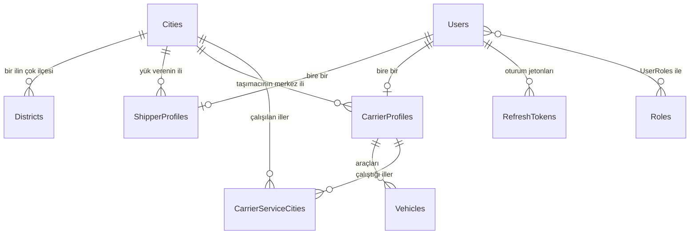

# SQL ve Veritabanı Rehberi

Bu rehber, projedeki **veritabanını** (SQL Server) hiç bilmeyen birinin okuyup anlayabilmesi için yazıldı. Kodun kendisi satır satır açıklamalıdır; bu belge veritabanı tarafının haritasıdır.

- Açıklamalı şema (gerçek SQL, sütun sütun açıklamalı): [`docs/veri/Sema.sql`](veri/Sema.sql)
- Hangi dosya ne işe yarar: [`docs/Backend_Rehberi.md`](Backend_Rehberi.md)
- Neden böyle karar verdik: [`docs/Karar_Kayitlari.md`](Karar_Kayitlari.md) (özellikle K-010, K-012, K-013, K-014, K-016)

---

## 1. Veritabanı nerede, kim tutuyor?

| Soru | Cevap |
|---|---|
| Hangi program? | **SQL Server 2025** (Microsoft'un veritabanı sunucusu) |
| Nerede çalışıyor? | **Docker** içinde, `yukum-sql` adlı konteynerde. Mac'te SQL Server doğrudan çalışmadığı için küçük bir Linux "kutusu" içinde çalışıyor |
| Adresi | `localhost`, port `1433` |
| Veritabanının adı | `Yukum` |
| Veri nerede saklanıyor? | Docker "birimi" (volume) `yukum-sql-data` içinde. Konteyneri kapatıp açsanız veri kalır |
| Uygulama hangi hesapla bağlanıyor? | `yukum_app` (yalnız `Yukum` veritabanında yetkili, sunucu yöneticisi **değil**) |
| Şifre nerede? | Hiçbir dosyada ve GitHub'da **yok**. Yalnız Mac'inizdeki gizli depoda (`user-secrets`) |

**Her gün başlarken:** Docker Desktop'ı açın, sonra Terminal'e `docker start yukum-sql` yazın.

---

## 2. Veritabanına nasıl bakarım? (3 yol)

### Yol A: VS Code içinde, tıklayarak (en rahatı)
1. VS Code'da **Extensions** (kare simge) → **"SQL Server (mssql)"** (yapımcı Microsoft) kur.
2. Sol kenarda yeni çıkan SQL Server simgesine tıkla → **Add Connection**.
3. Şunları gir: **Server** `localhost,1433` · **Database** `Yukum` · **Authentication** `SQL Login` · **User** `yukum_app` · **Password** (aşağıdaki komutla öğrenilir) · **Trust server certificate: Yes**.
4. Bağlandıktan sonra `Yukum → Tables` altında tüm tabloları görürsün; bir tabloya sağ tık → **Select Top 1000** yazarsan içeriği açılır.

Şifreyi görmek için Terminal'de (yalnız kendi bilgisayarında):

```
cd ~/Desktop/yükümüTası
dotnet user-secrets list --project backend/src/Yukum.Api
```

Çıkan `ConnectionStrings:DefaultConnection` satırında `Password=...` kısmı şifredir. **Bu şifreyi kimseye göndermeyin, ekran görüntüsüne almayın.**

### Yol B: Terminal'de komutla
```
docker exec yukum-sql bash -c '/opt/mssql-tools18/bin/sqlcmd -C -I -S localhost -U sa -P "$MSSQL_SA_PASSWORD" -d Yukum -W -Q "SELECT TOP 5 Id, Name FROM Cities ORDER BY Id;"'
```

Tırnaktaki SQL'i değiştirerek istediğinizi sorabilirsiniz. (`-I` bayrağı gerekli: filtreli indeksler bunu şart koşar. Şifreyi biz yazmıyoruz, konteynerin içinden okunuyor.)

### Yol C: API üzerinden
`http://localhost:5054/scalar` (API açıkken). İl ve ilçe listeleri doğrudan veritabanından gelir.

---

## 3. Tablolar ve aralarındaki ilişkiler (şema haritası)



GitHub bu şemayı otomatik çizer. Çizilmiyorsa metin hali:

```
Cities (81) ──< Districts (973)
   │
   ├──< ShipperProfiles ──── 1:1 ──── Users ──── Roles (UserRoles ile)
   ├──< CarrierProfiles ─── 1:1 ──── Users ──< RefreshTokens
   │        ├──< Vehicles
   │        └──< CarrierServiceCities >── Cities
```

Okuma: `A ──< B` = "bir A'nın çok B'si olur". `1:1` = "bire bir".

### Her tablo ne işe yarıyor?

| Tablo | Satır sayısı (şimdi) | Ne işe yarar |
|---|---|---|
| `Cities` | 81 | Türkiye'nin illeri. `Id` = plaka kodu (Konya = 42) |
| `Districts` | 973 | İlçeler. Her biri bir ile bağlı. `Id` 1-973, **donmuş** (değişmez) |
| `Users` | kayıtlar | Giriş yapabilen herkes: Yük Veren, Taşımacı, Admin. Şifre **hash** olarak durur |
| `Roles` | 3 | `Admin`, `Shipper` (Yük Veren), `Carrier` (Taşımacı) |
| `UserRoles` | kullanıcı sayısı | Hangi kullanıcı hangi rolde |
| `ShipperProfiles` | Yük Veren sayısı | Yük Veren'in firma, vergi, il bilgisi (kullanıcıyla bire bir) |
| `CarrierProfiles` | Taşımacı sayısı | Taşımacı'nın merkez ili, puanı vb. (kullanıcıyla bire bir) |
| `Vehicles` | araç sayısı | Taşımacının araçları (Tır, Kamyon, ...) |
| `CarrierServiceCities` | bölge sayısı | Taşımacının çalıştığı iller |
| `RefreshTokens` | oturum sayısı | Oturumu yenilemek için jeton kayıtları (D4'te dolacak) |

Identity'nin ayrıca `UserClaims`, `UserLogins`, `UserTokens`, `RoleClaims` tabloları da var; bu projede **kullanılmıyorlar** (boş kalır), Identity'nin standart parçası oldukları için duruyorlar.

Her sütunun anlamı için: [`docs/veri/Sema.sql`](veri/Sema.sql) dosyasını açın; her satırın yanında Türkçe açıklama var.

---

## 4. Kurallar veritabanının kendisinde (neden önemli?)

Bazı kuralları sadece kodda değil, **veritabanının içinde** de uyguluyoruz. Böylece kod hata yapsa bile veritabanı yanlış veriyi **kabul etmez**:

| Kural | Nasıl uygulanıyor |
|---|---|
| Aynı adlı iki il olamaz | `Cities.Name` üzerinde **UNIQUE** indeks |
| Aynı ilde aynı adlı iki ilçe olamaz | `Districts(CityId, Name)` üzerinde **UNIQUE** indeks |
| Olmayan bir ile ilçe eklenemez | `Districts.CityId` → `Cities.Id` **yabancı anahtar** (FK) |
| Aynı e-posta iki hesapta olamaz | `Users.NormalizedEmail` üzerinde UNIQUE indeks |
| Aynı telefon iki hesapta olamaz | `Users.PhoneNumber` üzerinde UNIQUE indeks (boşsa kontrol edilmez) |
| Aynı jeton iki kez saklanamaz | `RefreshTokens.TokenHash` UNIQUE |
| Kullanıcı silinirse profili, araçları, jetonları da silinir | FK'lerde **CASCADE** |
| Bir il silinirse ilçeleri sessizce silinmez | FK'de **NO ACTION** (silme engellenir) |
| Eşzamanlı çakışma | `RowVersion` sütunu: iki kişi aynı kaydı aynı anda değiştirirse ikincisi reddedilir |
| Silinen kayıt iz bırakır | `IsDeleted` işareti (yumuşak silme): kayıt gerçekte silinmez, gizlenir |

---

## 5. Örnek sorgular (kopyalayıp deneyebilirsiniz)

Hepsi **yalnız okur**, hiçbir şeyi değiştirmez. Yol A'da (VS Code) ya da Yol B'de çalıştırın.

**İlk 5 il**
```sql
SELECT TOP 5 Id, Name FROM Cities ORDER BY Id;
```
`SELECT` = göster, `TOP 5` = ilk beş, `FROM Cities` = Cities tablosundan, `ORDER BY Id` = Id'ye göre sırala.

**Konya'nın ilçeleri** (iki tabloyu birleştirir)
```sql
SELECT d.Id, d.Name AS Ilce, c.Name AS Il
FROM Districts d
JOIN Cities c ON c.Id = d.CityId
WHERE c.Name = N'Konya'
ORDER BY d.Id;
```
`JOIN ... ON` = iki tabloyu bağlayan ortak sütunla birleştir. `WHERE` = süzgeç. `N'Konya'` içindeki `N` = Türkçe karakterli (Unicode) metin.

**En çok ilçesi olan 5 il**
```sql
SELECT TOP 5 c.Name AS Il, COUNT(*) AS IlceSayisi
FROM Districts d
JOIN Cities c ON c.Id = d.CityId
GROUP BY c.Name
ORDER BY COUNT(*) DESC;
```
`COUNT(*)` = say, `GROUP BY` = gruplayarak, `DESC` = büyükten küçüğe. (İstanbul 39, Konya 31, İzmir 30...)

**Kullanıcılar ve rolleri**
```sql
SELECT u.Email, r.Name AS Rol, u.LockoutEnd
FROM Users u
JOIN UserRoles ur ON ur.UserId = u.Id
JOIN Roles r ON r.Id = ur.RoleId;
```
`LockoutEnd` boşsa hesap kilitli değildir.

**Bir taşımacının araçları**
```sql
SELECT u.FullName, v.VehicleType, v.PlateNumber, v.CapacityKg
FROM Vehicles v
JOIN Users u ON u.Id = v.CarrierId
WHERE v.IsDeleted = 0;
```
`VehicleType`: 1 = Tır, 2 = Kamyon, 3 = Kamyonet, 4 = Frigorifik, 99 = Diğer.

**Ne kadar kayıt var?**
```sql
SELECT (SELECT COUNT(*) FROM Cities)    AS Il,
       (SELECT COUNT(*) FROM Districts) AS Ilce,
       (SELECT COUNT(*) FROM Users)     AS Kullanici;
```

> **Uyarı:** `INSERT`, `UPDATE`, `DELETE` ya da `DROP` komutlarını geliştirme veritabanında bile **elle çalıştırmayın**. Şema değişikliği her zaman kodla (migration), veri değişikliği uygulamayla yapılır. Çalıştırmanız gerekiyorsa bana sorun.

---

## 6. SQL'i kim yazıyor? (EF Core, migration, seed)

Bu projede **SQL'i elle yazmıyoruz**. Üç parça birlikte çalışıyor:

1. **C# sınıfı = tablo.** `City.cs` bir sınıf, `Cities` tablosunun karşılığı. Sütunlar = sınıfın özellikleri.
2. **EF Core (ORM).** C# kodunu SQL'e çevirir. Örnek:
   ```csharp
   context.Districts.Where(d => d.CityId == 42).OrderBy(d => d.Id)
   ```
   aşağıdaki SQL'e dönüşür:
   ```sql
   SELECT ... FROM Districts WHERE CityId = 42 ORDER BY Id
   ```
3. **Migration = şemanın sürüm kaydı.** `dotnet ef migrations add AdiVer` komutu, tablolarda ne değiştiğini bir dosyaya yazar (`Persistence/Migrations`). `dotnet ef database update` o dosyayı veritabanına uygular. Şu an 3 migration var:
   - `InitialCreate` (boş şema),
   - `AddCitiesAndDistricts` (il/ilçe tabloları + 81 + 973 satır),
   - `AddAccounts` (kullanıcı, rol, profil, araç, jeton tabloları).
4. **Seed = başlangıç verisi.** İl, ilçe ve roller migration'ın içinde `INSERT` olarak gelir; veri kaynağı `docs/veri/il-ilce.json`.

Gerçek SQL'i görmek için:
```
cd ~/Desktop/yükümüTası/backend
dotnet ef migrations script --project src/Yukum.Infrastructure --startup-project src/Yukum.Api
```

---

## 7. Küçük sözlük

| Terim | Anlamı |
|---|---|
| **Tablo** | Excel sayfası gibi: satırlar (kayıtlar) ve sütunlar |
| **PK (Primary Key)** | Her satırı tek başına tanıyan sütun (örn. `Cities.Id`) |
| **FK (Foreign Key)** | Başka bir tabloya işaret eden sütun (örn. `Districts.CityId` → `Cities.Id`). Var olmayan kayda işaret edilemez |
| **UNIQUE** | O sütunda (ya da sütun çiftinde) aynı değer iki kez olamaz |
| **İndeks** | Kitabın dizini gibi: aramayı hızlandırır; UNIQUE ise tekrar yasağı da getirir |
| **NULL** | "Boş / bilinmiyor". `NOT NULL` = boş bırakılamaz |
| **JOIN** | İki tabloyu ortak sütundan birleştirmek |
| **Transaction (işlem)** | Bir grup işlemin ya hepsi yazılır ya hiçbiri (kayıtta kullanıcı + profil birlikte) |
| **CASCADE** | Ana kayıt silinince bağlı kayıtlar da silinir |
| **Yumuşak silme** | Kaydı silmek yerine `IsDeleted = 1` yapmak; iz kalır, sorgularda görünmez |
| **Hash** | Şifrenin geri döndürülemez özeti. Şifrenin kendisi hiçbir yerde saklanmaz |
| **Migration** | Şema değişikliğinin sürümlü kaydı (kodla birlikte GitHub'da durur) |
| **Seed** | Veritabanı kurulurken otomatik yüklenen başlangıç verisi |
| **Konteyner / Docker** | Programı (SQL Server) kendi küçük ortamında çalıştıran kutu |
